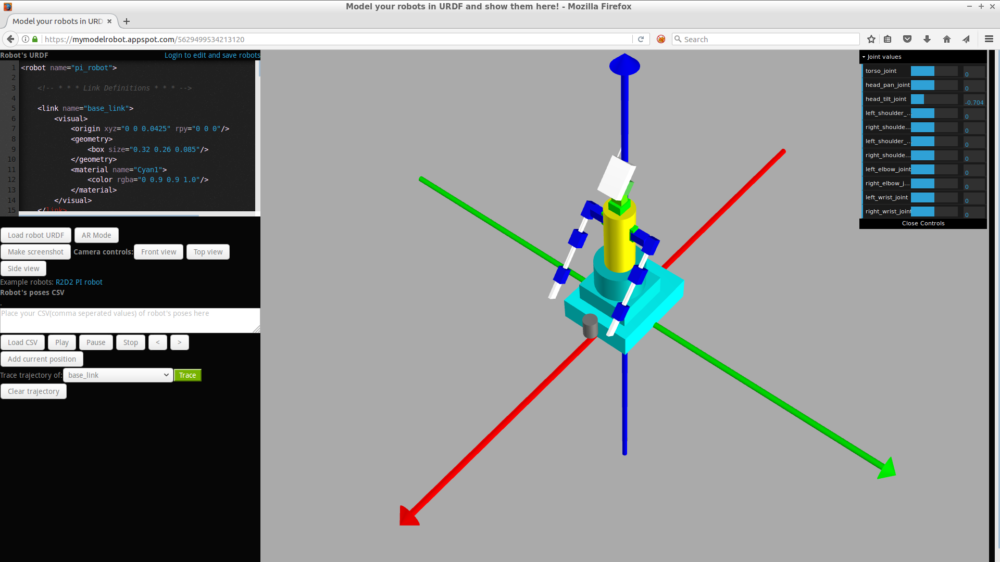

MyModelRobot
==========

MyModelRobot is a web-based application for designing and viewing robots described in URDF (Unified Robot Description Format) used in ROS. 

The tool focuses on simplicity of use, especially for teaching and rapid prototyping. The tool is used in Lodz University of Technology robotics curriculum (basics of robotics, mobile robotics and project work).

The main viewer supports URDF primitives and locally loaded STL meshes. You can move robot's joints using sliders and animate robots via CSV files. You can also view robots using Augmented Reality (AR).



## Quick Start

### Standalone Version (Recommended)

The easiest way to use MyModelRobot is the standalone version that requires no server setup:

1. Clone or download this repository
2. Open `standalone.html` in your web browser
3. Start designing and viewing robots!

For detailed instructions, see [INSTALL.md](INSTALL.md)

### Online Demo

You can also try the online demo at [http://mymodelrobot.appspot.com/](http://mymodelrobot.appspot.com/)

## Features

- **URDF Visualization**: Load and display robot models in 3D
- **Joint Controls**: Interactive sliders for moving robot joints
- **Languages**: English and Polish interface with a language choice saved in the browser
- **CSV Animation**: Animate robots with predefined joint trajectories
- **Multiple Views**: Front, top, and side camera presets
- **Augmented Reality**: View robots in AR mode
- **Screenshots**: Capture images of your robot models
- **Trajectory Tracing**: Visualize link paths during animation

## Documentation

- [INSTALL.md](INSTALL.md) - Detailed installation and usage instructions
- Example URDF files in the `testowe/` directory

## License

See repository for license information.

Browser robot library and STL meshes
-----------------------------------

The hosted homepage now serves the standalone viewer directly as static files.
Robot loading and browser storage require no application server. Existing
server robot URLs remain available through the legacy backend.

Use **URDF and STL files** to select a URDF/XML file and its ASCII or binary
STL meshes, or choose a folder to preserve mesh paths. STL files can also be
added before or after loading the URDF. Mesh references resolve by path and,
when unique, by filename, including `package://` references. Ambiguous or missing
meshes are listed in the viewer. URDF mesh scale, visual origin and material
are applied; STL coordinates are not automatically converted from millimeters.

Each loaded robot is saved automatically in IndexedDB with its referenced mesh
bytes and CSV animation. CSV edits are saved automatically and restored when
the robot is reopened. Use **Saved robots → Open** to restore it, **Save in browser** to update
its name, and **Delete saved robot** to remove its saved copy. Storage belongs
to this browser and site; clearing site data removes it. Local files are not
uploaded to the server. Existing server saves contain URDF only.

The main viewer bundles Three.js 0.187.0, its OrbitControls and STLLoader
locally. The camera-based AR page retains its legacy runtime for compatibility
with the existing AR library; local mesh robots are supported in the main viewer.

Build and check with Node.js 22+ and Python 3 with Jinja2 installed:

```sh
npm ci
npm run build
npx playwright install chromium
npm test
```

The workspace has URDF, Files, Joints and Animation tabs, a tall resizable editor,
and a camera toolbar with six standard views and an isometric view. Upright
orbit controls provide pan and zoom with visible gesture hints. Applied edits
preserve the current document, CSV, joint pose and camera view.

An opt-in integration check has been run against the NASA/JPL T12 model from
[gkjohnson/urdf-loaders](https://github.com/gkjohnson/urdf-loaders/tree/c8c25c8cf6fcb84929b9a03ff866139a8a1e2a01/urdf/T12).
It verifies all 37 STL visuals, 36 joints, URDF transforms, browser restoration,
and CSV-driven joint motion. To rerun after downloading its T12.URDF and meshes:

```sh
node tests/check-external-robot.cjs /path/to/T12
```

Deploy to Google App Engine with the personal account explicitly selected:

```sh
gcloud auth login reinadesu@gmail.com --no-launch-browser
bash scripts/deploy_google.sh --quiet
```
