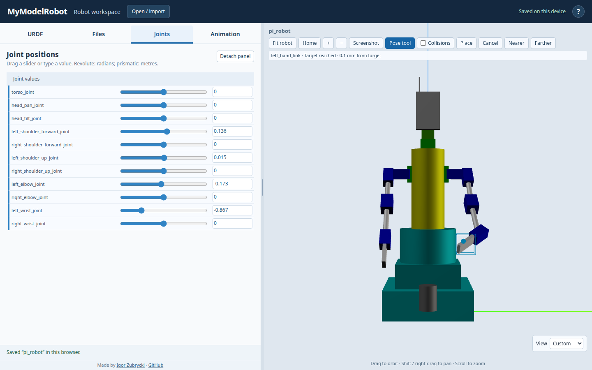
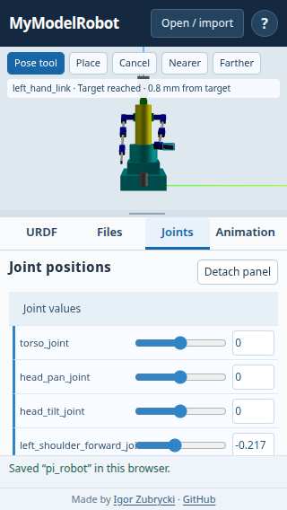

# MyModelRobot development notes — 6 November 2026

These notes explain what changed, why the choices were made, and how the work
was checked. They are intended as material for a project presentation.

## Starting point and earlier work

The public application had fallen behind the repository's newer standalone
viewer. Work on **4 November**, before the changes described below, restored
that viewer as the static homepage, added local STL loading and an IndexedDB
robot library, saved CSV animations with their robots, and upgraded the main
viewer to Three.js r187. Robot files and mesh bytes stay in the browser. The
legacy AR page retains its older runtime.

That earlier work also corrected default Pi loading, resizing and stale asset
caches, introduced standard camera views and light controls, and moved the
App Engine backend to Python 3.12. These are background capabilities, not
features first added on 6 November.

## Making editing and posing easier

**Problem:** Editing URDF, adjusting joints and controlling the camera required
too much switching and scrolling. Applying small edits disrupted the working
session. An independent GPT-6 Astra usability review examined the application
and checked the revised workspace.

**Choices and implementation:**

- Separate URDF, Files, Joints and Animation tabs make each task easier to find.
  A resizable preview/editor split and a taller editor give the source usable
  space. The phone layout keeps the preview above the workspace; short landscape
  screens use a side-by-side arrangement.
- Applying URDF keeps the document identity, CSV, joint pose, camera, editor
  cursor and scroll position. Save a copy explicitly creates another document.
  Reopening the default robot also preserves its user-assigned library name.
- Upright Z-up OrbitControls replace the difficult rolling camera behavior.
  Fit, Home, zoom, standard views and visible gesture hints explain navigation.
- A compact Help button documents the controls. CSV templates, validation,
  pose counts and warning badges make animation errors easier to locate.
- Joint controls can detach into a draggable, resizable panel alongside URDF
  or CSV. The same controls move between docked and floating locations, avoiding
  two independent panels that could display different values.
- Mouse-only slider tracks were replaced with native range inputs. On phones,
  the detached panel stays compact and scrolls internally rather than covering
  the screen. Numeric inputs and keyboard adjustment remain available.

**Evidence:** commits `810fbad`, `8c93008`, `7044b6c`, `b222e35` and `c2e41ec`.
See [the usability review](usability-review-2026-11-06.md) for findings and checks.
Touch checks use Chromium's actual touch-event emulation; they are not tests
on physical Android or iOS hardware.

## Optional collision warnings

**Goal:** Make collisions visible while posing without introducing a physics
engine or preventing users from exploring a pose.

**Choices:** Checking is initially off and enabled with a checkbox. Only explicit
URDF `<collision>` geometry participates; visual geometry is not an implicit
fallback. Potentially colliding links turn red, and a status line names the pairs.
Original materials return when overlap ends or checking is disabled.

**Method:** Boxes, spheres, cylinders and local STL collision meshes are enclosed
in oriented bounding boxes. Collision origins, roll/pitch/yaw and signed mesh
scales are applied. An axis-aligned broad phase rejects distant pairs before
Three.js's oriented-box separating-axis test. Fixed joints form rigid assemblies;
shapes in the same or directly neighboring assemblies are excluded to avoid
routine warnings at connections. Changed poses are checked at most once per
50 ms. Unsupported or missing geometry produces an incomplete-check warning.

**Demo and correction:** The initial Pi demo tagged the hands and torso and added
bending elbows plus a deliberately colliding pose. A user then demonstrated
arms crossing the torso without a warning: those arm segments lacked collision
tags. The correction tagged every section of both arms, bringing coverage to
15 shapes, and added shoulder-limit and crossed-arm regression cases. The
status now explicitly refers to tagged shapes.

**Limits:** Curved and irregular shapes are conservatively boxed, so warnings
can precede actual surface contact. There is no collision response, environment
collision, or continuous sweep test; fast motion can skip an overlap between
checked poses. These exclusions are viewer choices, not universal URDF rules.

**Evidence:** commits `5c71882` and `a903f0d`; see
[collision checking](collision-checking.md). A NASA/JPL T12 model check loaded
37 STL collision shapes and 37 visuals without missing geometry. Ericson's
*Real-Time Collision Detection* was downloaded as a local reference, excluded
from Git and deployment; the application uses Three.js's existing OBB algorithm.

## Interactive inverse kinematics

The user chose the following interaction before implementation:

| Choice | Reason | Behavior |
| --- | --- | --- |
| Double-click plus a Pose tool button | Quick access while retaining ordinary camera use | Double-click a segment, or enable the tool and click it |
| Screen-facing plane plus depth control | A 2D pointer cannot uniquely specify a 3D point | The picked point follows the cursor; wheel or Nearer/Farther changes depth |
| Selected limb | Moving a hand should not unexpectedly rotate the torso or recruit the other arm | Solve ancestors only as far as the nearest branching rigid assembly |

**Initial interaction:** The exact picked surface point was the positional target,
rather than an arbitrary link origin. A cyan target marker, segment outline and connecting
line expose the selection and residual error without replacing collision colors.
Click again or choose Place to keep the pose. Cancel or Escape restores the joint
values at selection time; Escape again exits the tool. On touch screens, enable
the tool, drag a segment, and release to place it.

**Solver:** Axis-constrained cyclic coordinate descent (CCD) adjusts one scalar
URDF joint at a time, starting near the selected segment and working toward its
anchor. Revolute/continuous adjustments use the angle between vectors projected
onto the joint's rotation plane; prismatic adjustments project positional error
onto the sliding axis. Each joint's origin and axis are transformed into world
coordinates. Fixed links are collapsed before counting branches, so decorative
attachments do not prematurely stop a serial limb.

The solver uses bounded sweeps and a soft per-frame time budget, retains the best
pose found, and tries deterministic alternate offsets if a straight chain or joint
limit traps the local search. Joint axes are normalized and explicit zero limits
are preserved. Continuous joints use equivalent wrapped angles during IK. The
solver works directly with URDF joints; Three.js's bone CCD solver expects a
SkinnedMesh and is not a direct fit for this application's link hierarchy.

**Integration:** Playback pauses without rewinding when posing starts. Joint
sliders, tracing and optional collision warnings follow the accepted pose.
Manual joint controls, playback, camera commands and preview resizing finish
the active manipulation; applying or replacing a robot cancels it before the
old objects are disposed. Posing does not rewrite CSV. Existing Animation tools
can capture the resulting joint values.

**Limits:** IK targets position only, not orientation. The base stays fixed.
Unsupported joint types or segments without movable ancestors give a message.
Unreachable targets retain a best local result with a distance readout; the
search does not guarantee a globally optimal solution or avoid collisions.

The [7 November follow-up](ik-follow-up-2026-11-07.md) changes the target to the
segment's visual centre with a retained grab offset, avoiding elbow-casing twists
and explicitly checking downstream bend preservation and prismatic movement.

On small screens, camera-view overlays hide while Pose mode is enabled, and
camera buttons are replaced by the active posing actions while a segment moves.
This prevents the controls from covering the segment being picked.

Desktop and 320 px phone screenshots from the local build:

## Working and verification method

1. Inspect source, repository history and the live behavior to establish what is
   actually deployed. Reproduce reported problems before changing their cause.
2. Agree on meaningful interaction tradeoffs. Keep independent controls connected
   to one robot state, and retain the existing browser-only file workflow.
3. Add focused numerical tests and browser regression scenarios. Check failure
   cases as well as the visible happy path, and inspect desktop/phone screenshots.
4. Build the tracked JavaScript from CoffeeScript and the frontend modules;
   commit only the intended changes, preserving unrelated working-tree edits.
5. Deploy a preview using the explicit personal account `reinadesu@gmail.com`
   and project `mymodelrobot`, run checks against that version, then promote and
   verify the main URL. The company account is not used for deployment.

The automated checks cover file loading, saved STL/CSV data, session preservation,
camera controls, resizing, detachable sliders, collision bounds/materials and IK.
IK cases include transformed axes, prismatic and rotational limits, fixed-group
branch isolation, singular starts, a joint-limit local minimum, unreachable
targets, STL/primitive picking, depth changes, commit/cancel, animation handoff,
robot rebuilds and touch dragging. Deployment results are recorded below.

## Short demonstration sequence

1. Open the Pi robot and show the editor, standard views and Help.
2. Detach Joints, change a value alongside URDF, then apply a small edit to show
   that the pose and working session remain intact.
3. Enable Collisions and choose Pi collision demo. Show red links and pair names;
   return to the safe pose and move an arm inward to demonstrate full arm coverage.
4. Double-click a hand, move its target, adjust depth and place it. Repeat and
   cancel to demonstrate exact pose restoration and the stationary other limb.
5. Capture a pose in CSV and play it; show that animation, sliders and collision
   feedback share the same state. Demonstrate local STL loading and reopening
   a saved robot if presentation time allows.
6. Show the responsive phone controls and the footer credit linking to
   [Igor Zubrycki's site](https://gentle.pl/) and the
   [project repository](https://github.com/AdoHaha/modelrobot).

## Release record

- Before IK: production version `arm-collisions-20261106`, commit `a903f0d`.
- IK implementation: all 16 local automated tests pass. The separate T12 check
  also passes (37 mesh visuals/collision shapes, 36 joints, saved CSV and motion).
  The default Pi hand was checked in front view on desktop and with emulated
  touch at 320 × 568; the torso and opposite limb stayed unchanged.
- Implemented in commit `ab2d5f2`; the interaction choices above are implemented,
  rather than remaining proposed work.
- Preview version `ik-20261106` passed all 16 automated tests. It was promoted
  to 100% of the default service's traffic at
  [mymodelrobot.appspot.com](https://mymodelrobot.appspot.com/).
- All three IK browser scenarios passed again on the main URL after promotion:
  picking/placement, animation and rebuild lifecycle, and touch dragging.
- The deployment explicitly used project `mymodelrobot` and personal account
  `reinadesu@gmail.com`. Refresh an already-open viewer to load the new assets.
