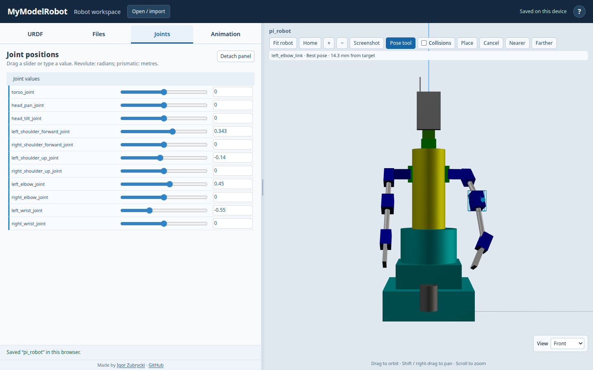

# IK follow-up — 7 November 2026

## Report and intended behavior

Moving a middle segment made the attached end segments swing unexpectedly.
The intended behavior is to keep downstream bend angles unchanged: the forearm
and hand follow the selected segment, rather than holding the hand fixed in
world space.

## Cause

The first version targeted the exact surface point under the cursor. A point
on an elbow casing is slightly off the hinge axis, so the solver could improve
its position by spinning the elbow dramatically. In a reproduced Pi case, a
30 mm target displacement caused an elbow rotation of more than 100 degrees.
The wrist's relative angle did not change, but the entire distal assembly swung
with the elbow. Position-only error did not distinguish this unwanted twist
from a useful movement.

## Correction and choice

- Target the centre of the selected link's own visual bounds, computed in the
  link's coordinate frame. Exclude descendant visuals so changing hand posture
  does not change an elbow's handle location. This works with primitives, STL
  meshes, multiple visuals, visual origins and mesh scales.
- Preserve the initial world-space cursor-to-centre offset. Picking does not
  move the segment; the cursor marker and depth controls retain their existing
  behavior. The exact skin point is no longer an orientation constraint.
- Leave rotational joints unchanged when their axis passes through the handle:
  they cannot move that handle's position. Apply this to both normal CCD updates
  and alternate search seeds; otherwise a seed could introduce a useless twist.
- Continue solving only ancestors, retaining every downstream joint value and
  therefore the hand's configuration relative to the selected segment. This is
  not a world-space hand lock or an orientation IK solver.
- Prismatic joints remain active even when the handle is on the axis. Their
  movement translates the handle along that axis, subject to the travel limits.

To bend an elbow directly, grab its forearm. Picking the casing centred on
the hinge moves that hinge using upstream joints instead of spinning it.

## Verification

Added numerical checks for middle-link rotations, distal bend/transform
preservation and a prismatic middle-link handle with an articulated descendant.
The browser regression starts with nonzero Pi elbow/wrist bends, grabs an
off-centre elbow point, moves its target and verifies that only the shoulder
angles change. It checks the hand transform relative to the elbow and exact
Cancel restoration. The existing browser interaction check also moves a
prismatic carriage through the Pose tool.

Local visual check, with the elbow kept at 0.45 rad and wrist at −0.55 rad:

Release results will be recorded after local, preview and production checks.
